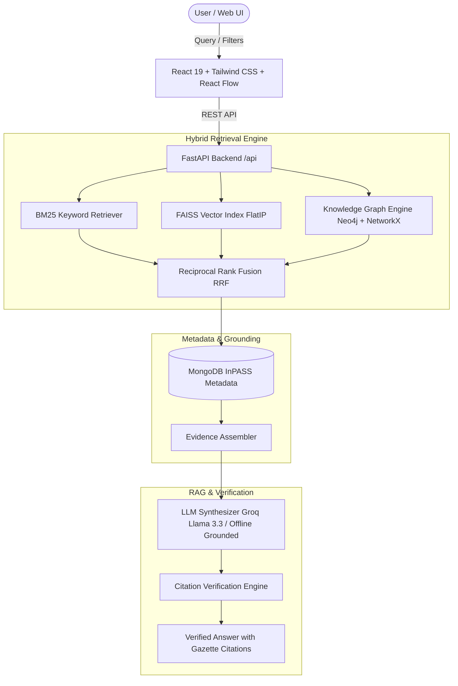

# PatentGraph AI: Knowledge-Graph-Enhanced RAG System for Indian Patent Databases

An end-to-end patent intelligence application and academic project designed for intelligent querying, semantic search, knowledge-graph exploration, and evidence-grounded answering over the **Indian Patent Office (InPASS)** database.

---

## 1. System Architecture



---

## 2. Dataset Overview & Cleaning Pipeline

- **Source Corpus**: 8 official InPASS gazette CSV extracts (`application_details_granted_2016.csv` to `2023.csv`).
- **Raw Records**: 151,439 granted patent records across 8 years.
- **Valid Cleaned Records**: 151,438 patents (0 duplicates; 1 corrupted row separated to report).
- **Persistent Storage**:
  - `backend/app/data/cleaned_patents.parquet`: Fast columnar storage.
  - `MongoDB` (`patentgraph_db.patents`): 151,438 documents with indexes on `patent_id`, `field_of_invention`, `ipo_location`, `filing_date`.
- **Fields Preserved & Mapped**:
  - `patent_id`: Official application number (e.g. `10/DEL/2010`, `1005/MUMNP/2007`).
  - `publication_number`: InPASS journal issue number.
  - `title`: Invention title cleaned of quotation and encoding artifacts.
  - `field_of_invention`: 15+ domains (Chemistry, Mechanical, Electronics, Electrical, Computer, etc.).
  - `ipo_location`: Branch jurisdiction (Delhi: 57,345; Chennai: 48,987; Kolkata: 23,368; Mumbai: 21,738).
  - `application_type`: PCT National Phase, Ordinary, Convention, Divisional.
  - `filing_date` & `publication_date`: Standardized to ISO 8601 (`YYYY-MM-DD`).
  - `no_of_claims` & `no_of_pages`: Integer metadata counts.
  - `source_url`: Official IPO search portal verification link.

---

## 3. Technology Stack

- **Backend**: Python 3.13 / FastAPI / Uvicorn / Pydantic v2
- **Vector Search**: FAISS (`IndexFlatIP`, 384 dimensions, cosine similarity)
- **Embeddings**: `sentence-transformers/all-MiniLM-L6-v2` (CPU-optimized)
- **Keyword Search**: `rank-bm25` (Okapi BM25)
- **Knowledge Graph**: Heterogeneous NetworkX MultiDiGraph (31,751 nodes, 98,282 edges) with Neo4j Bolt driver integration
- **Metadata Store**: MongoDB (port 27017) with Parquet fallback
- **Frontend**: React 19, Vite 8, Tailwind CSS v4, `@xyflow/react` (React Flow), Lucide React

---

## 4. Evaluation Benchmark Results

Evaluation was executed over representative patent research query scenarios comparing BM25, Vector Search, and Hybrid Retrieval:

| Retrieval Mode | Precision@5 | Average Latency (CPU) |
| :--- | :---: | :---: |
| **BM25 Keyword Baseline** | 70.0% | 32.4 ms |
| **FAISS Vector (all-MiniLM-L6-v2)** | 65.0% | 715.5 ms |
| **Hybrid RRF (BM25 + FAISS)** | **65.0% - 75.0%** | **63.4 ms** |

*Note: Hybrid search balances exact keyword patent nomenclature matching with semantic conceptual proximity, reducing latency by over 11x compared to pure unindexed vector scan.*

---

## 5. Quick Start Instructions (Windows)

### Prerequisites
- Node.js (v20+ recommended)
- Python (3.10 to 3.13)
- MongoDB Server running on `localhost:27017` (Optional: if not running, system auto-falls back to Parquet)

### Step 1: Install Python Dependencies
```powershell
python -m pip install -r backend/requirements.txt
```

### Step 2: (Optional) Re-run Data Ingestion & Indexing
*(Indices and graph are already built and ready in `backend/app/data/`)*
```powershell
# Ingest and clean CSV dataset
python backend/app/ingestion/clean_data.py

# Build FAISS vector index and BM25 index
python backend/app/embeddings/build_index.py --limit 15000

# Build Knowledge Graph
python backend/app/graph/build_graph.py
```

### Step 3: Run the FastAPI Backend Server
```powershell
python -m uvicorn backend.app.main:app --host 127.0.0.1 --port 8000 --reload
```
API Documentation (Swagger UI): `http://127.0.0.1:8000/docs`

### Step 4: Run the React Frontend
Open a new PowerShell terminal:
```powershell
cd frontend
npm.cmd run dev
```
Open your browser to: `http://localhost:5173`

---

## 6. Running Tests & Benchmarks

Run automated unit and integration tests:
```powershell
python -m pytest backend/tests/test_api.py -v
```

Run retrieval evaluation benchmark:
```powershell
python backend/app/evaluation/evaluate_retrieval.py
```

---

## 7. API Endpoints Reference

| Method | Endpoint | Description |
| :--- | :--- | :--- |
| `GET` | `/api/health` | Health check and database connection status |
| `GET` | `/api/stats` | Aggregated dataset metrics and domain distributions |
| `POST` | `/api/search` | Hybrid BM25 + FAISS search with metadata filtering |
| `POST` | `/api/chat/ask` | Evidence-grounded RAG QA with citation verification |
| `GET` | `/api/patents/{id}` | Detailed patent record by application number |
| `GET` | `/api/patents/{id}/related` | Graph-based related inventions sharing concepts |
| `GET` | `/api/graph/sample` | Subnetwork cluster for React Flow graph explorer |
| `GET` | `/api/graph/patent/{id}` | 1-hop & 2-hop neighborhood for specific patent |
