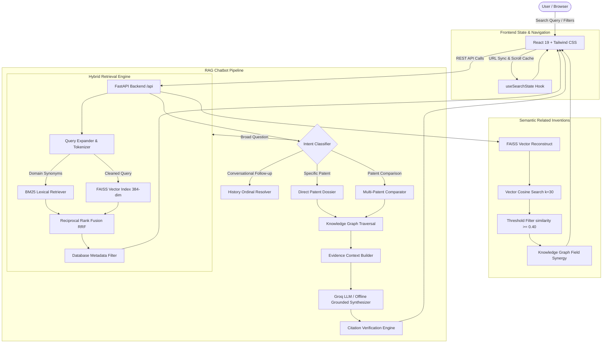

# PatentGraph AI: Knowledge-Graph-Enhanced RAG System for Indian Patent Databases

[](https://fastapi.tiangolo.com)
[](https://react.dev)
[](https://tailwindcss.com)
[](https://github.com/facebookresearch/faiss)
[](#)

An enterprise-grade patent intelligence platform and academic project designed for intelligent querying, semantic search, technology exploration, and evidence-grounded answering over official **Indian Patent Office (InPASS)** gazette records.

---

## 1. Project Overview & Problem Statement

### The Problem
Traditional patent search portals rely heavily on exact boolean keyword matching. If an inventor or researcher searches for *"farming"*, but the official patent gazette uses formal terminology like *"controlled agricultural cultivation"*, traditional keyword engines return zero or incomplete results. Furthermore, generic Large Language Models (LLMs) frequently hallucinate fictional patent numbers, non-existent claims, and invented legal statuses.

### The Solution
**PatentGraph AI** bridges this gap by combining:
1. **Hybrid Retrieval**: Dense vector embeddings (`sentence-transformers/all-MiniLM-L6-v2` with FAISS) and sparse lexical search (Okapi BM25) blended via **Reciprocal Rank Fusion (RRF)**.
2. **Domain-Specific Query Expansion**: Automatic mapping of colloquial terminology to formal Indian patent taxonomy (e.g., *farming* &rarr; *agriculture*, *cultivation*, *crop*, *tillage*).
3. **Semantic Related Inventions**: Deep vector-similarity recommendations with transparent match explanations, shared technical concepts, and honest empty states when candidate confidence is below 40%.
4. **Knowledge Graph Traversal**: A heterogeneous graph of **44,223 nodes and 137,888 edges** connecting patents to technology domains (`FIELD_*`), IPO branch offices (`LOC_*`), and application types.
5. **Anti-Hallucinatory RAG Chatbot**: Multi-intent question answering supporting single-patent technical deep dives, side-by-side comparative analysis, conversational follow-ups (*"Explain the second patent"*), and verified InPASS citations.
6. **State Persistence & Scroll Restoration**: Full session state persistence via URL query parameters and RequestAnimationFrame-deferred scroll restoration.

---

## 2. System Architecture



---

## 3. Complete Files & Folder Structure

```
miniproject/
│
├── backend/                             # Python FastAPI Backend
│   ├── app/
│   │   ├── api/                         # REST API Route Controllers
│   │   │   ├── health.py                # Health check endpoint (/api/health)
│   │   │   ├── router.py                # Main API router registry
│   │   │   └── routes/
│   │   │       ├── chat.py              # RAG Chatbot endpoints (/api/chat/ask)
│   │   │       ├── graph.py             # Internal graph query endpoints
│   │   │       ├── patents.py           # Patent details & related inventions (/api/patents)
│   │   │       ├── search.py            # Hybrid search endpoint (/api/search)
│   │   │       └── stats.py             # Technology explorer statistics (/api/stats)
│   │   │
│   │   ├── core/
│   │   │   └── config.py                # Pydantic BaseSettings, env resolution, CORS
│   │   │
│   │   ├── data/                        # Persistent Offline Datasets & Indexes
│   │   │   ├── cleaned_patents_2016_2018.parquet  # Columnar dataset (33,825 records)
│   │   │   ├── faiss_index_2016_2018.bin          # FAISS FlatIP 384-dim vector index
│   │   │   ├── faiss_id_map_2016_2018.json        # Forward & reverse index-to-patent ID map
│   │   │   ├── bm25_index_2016_2018.pkl           # Pre-indexed BM25 Okapi corpus
│   │   │   └── knowledge_graph_2016_2018.pkl      # NetworkX MultiDiGraph (44k nodes, 137k edges)
│   │   │
│   │   ├── database/                    # Database Connectors & Offline Fallbacks
│   │   │   ├── mongodb.py               # MongoDB Atlas client with Parquet fallback
│   │   │   ├── neo4j_client.py          # Neo4j Bolt/HTTPS client with NetworkX fallback
│   │   │   └── qdrant_client.py         # Qdrant Cloud client with FAISS fallback
│   │   │
│   │   ├── embeddings/
│   │   │   └── embedding_model.py       # SentenceTransformers (all-MiniLM-L6-v2) loader
│   │   │
│   │   ├── graph/
│   │   │   └── graph_queries.py         # Graph traversal, entity expansion & schema queries
│   │   │
│   │   ├── retrieval/                   # Retrieval Pipeline
│   │   │   ├── hybrid_search.py         # RRF fusion engine combining BM25 and vector search
│   │   │   ├── keyword_search.py        # BM25 lexical retriever
│   │   │   ├── query_expander.py        # Patent taxonomy synonym expansion & query cleaner
│   │   │   └── vector_search.py         # FAISS vector similarity search & vector extraction
│   │   │
│   │   ├── schemas/                     # Pydantic v2 Data Models
│   │   │   ├── chat.py                  # ChatRequest, ChatResponse, ChatCitation, Verification
│   │   │   ├── patent.py                # PatentBase, PatentFrontendFormat
│   │   │   └── search.py                # SearchFilters, SearchResultItem, SearchResponse
│   │   │
│   │   ├── services/                    # Core Business Logic
│   │   │   ├── patent_service.py        # Patent lookup, related inventions, description synthesis
│   │   │   ├── rag_service.py           # Multi-intent RAG generation & grounded synthesis
│   │   │   ├── structured_query_service.py # Natural language SQL/count query interpreter
│   │   │   └── verification_service.py  # Fact verification & citation grounding validator
│   │   │
│   │   ├── utils/
│   │   │   └── rag_logger.py            # Structured tracing & performance metric logger
│   │   │
│   │   └── main.py                      # FastAPI application entrypoint & startup lifespans
│   │
│   ├── tests/                           # Automated PyTest Test Suite (58 Tests Passed)
│   │   ├── test_rag_accuracy.py         # Anti-hallucination & evidence grounding tests
│   │   ├── test_rag_multi_intent.py     # Comparison, specific lookup, and follow-up tests
│   │   ├── test_related_inventions.py   # Semantic similarity & empty-state tests
│   │   ├── test_search_state_persistence.py # State restoration, keys & scroll tests
│   │   └── test_target_queries.py       # Target domain search queries test
│   │
│   ├── .env                             # Private runtime environment variables (git-ignored)
│   ├── .env.example                     # Public template showing required variables
│   └── requirements.txt                 # Backend Python package dependencies
│
├── frontend/                            # React 19 Frontend (Vite)
│   ├── public/                          # Static assets (logo, favicon)
│   ├── src/
│   │   ├── components/
│   │   │   ├── Footer.jsx               # Application footer
│   │   │   ├── Navbar.jsx               # Top navigation bar
│   │   │   ├── PatentCard.jsx           # Individual patent card component
│   │   │   └── Sidebar.jsx              # Responsive navigation sidebar
│   │   │
│   │   ├── hooks/
│   │   │   └── useSearchState.js        # State synchronization & scroll position management
│   │   │
│   │   ├── pages/
│   │   │   ├── AIAssistant.jsx          # Interactive RAG chat UI with debug transparency
│   │   │   ├── Explorer.jsx             # Technology domain analytics & charts
│   │   │   ├── Home.jsx                 # Landing page & repository overview
│   │   │   ├── KnowledgeGraph.jsx       # Clean redirect to Explorer
│   │   │   ├── PatentDetails.jsx        # Patent view, abstract/description & related inventions
│   │   │   └── Search.jsx               # Stateful hybrid patent search interface
│   │   │
│   │   ├── services/
│   │   │   └── api.js                   # API client for backend communication
│   │   │
│   │   ├── App.jsx                      # Main routing configuration
│   │   ├── index.css                    # Global Tailwind CSS styles
│   │   └── main.jsx                     # React entrypoint
│   │
│   ├── package.json                     # Frontend npm dependencies & build scripts
│   └── vite.config.js                   # Vite bundler configuration
│
├── migration/                           # Cloud database setup & migration scripts
├── ml_pipeline/                         # ML classification & prediction scripts
├── reports/                             # Data quality audits, data dictionary & cleaning logs
├── scripts/                             # Raw dataset preprocessing & validation scripts
├── .gitignore                           # Git ignore definitions
└── README.md                            # Complete Project Documentation
```

---

## 4. Key Features Detailed

### 1. Hybrid Search with Reciprocal Rank Fusion (RRF)
- Combines BM25 and vector search scores using formula:
  $$RRF\_Score(d) = \sum_{m \in M} \frac{w_m}{k + \text{rank}_m(d)}$$
- Domain Query Expander maps user phrases:
  - `"farming"` &rarr; `"farming agriculture agricultural crop cultivation harvester farm"`
  - `"machine learning"` &rarr; `"machine learning artificial intelligence neural network deep learning"`
- Instant Promotion: Queries matching exact patent application numbers (`10/DEL/2010`) or publication issues (`01/2016`) are placed at **Rank #1 with 100% relevance score**.

### 2. Semantic Related Inventions
- Reconstructs 384-dimensional dense vectors directly from the pre-computed FAISS index in `<1ms`.
- Excludes the current patent and duplicate entries.
- Enforces a minimum cosine similarity threshold of **0.40** (40%).
- Displays transparent match reasons and concept tags (e.g. *#pharmaceutical*, *#cultivation*).
- Outputs an honest empty state when no sufficiently related candidates exist.

### 3. Context-Aware Anti-Hallucinatory RAG Chatbot
- **Single Patent Inquiries**: Formulates complete technical dossiers (domain, problem addressed, filing chronology, claim counts).
- **Patent Comparisons**: Renders structured side-by-side comparative Markdown tables analyzing differences in domains, offices, filing timelines, and claim boundaries.
- **Conversational Follow-ups**: Resolves ordinal references (*"Explain the second patent"*, *"Compare it with the first"*) by inspecting prior assistant conversation turns.
- **Verification Engine**: Compares claimed citations against retrieved evidence to verify grounding ratio.

### 4. Search State Persistence & Scroll Restoration
- Preserves search queries, active filters, pagination, sort order, and exact scroll position.
- Uses session-scoped storage combined with URL synchronization (`?q=...&field=...&page=...`).
- Guarantees seamless browser Back/Forward navigation.

---

## 5. Technology Stack

| Layer | Technologies Used |
| :--- | :--- |
| **Backend Framework** | Python 3.10+, FastAPI, Uvicorn, Pydantic v2, Pydantic-Settings |
| **Vector Search** | FAISS (`IndexFlatIP`, 384 dimensions, cosine similarity) |
| **Embeddings** | `sentence-transformers/all-MiniLM-L6-v2` (offline-enabled) |
| **Lexical Search** | `rank-bm25` (Okapi BM25) |
| **Knowledge Graph** | NetworkX MultiDiGraph (44k nodes, 137k edges), Neo4j Bolt / HTTPS |
| **Metadata Storage** | Apache Parquet (33,825 records), MongoDB Atlas |
| **Frontend Framework** | React 19, Vite 8, React Router v7 |
| **Styling & Icons** | Tailwind CSS v4, Lucide React |

---

## 6. Database Connectivity & Resilient Fallbacks

The application is engineered with **zero-downtime offline fallbacks**:

| Component | Cloud / Primary Service | Offline Fallback Engine | Fallback Data Asset |
| :--- | :--- | :--- | :--- |
| **Metadata DB** | MongoDB Atlas | In-Memory Parquet DataFrame | `backend/app/data/cleaned_patents_2016_2018.parquet` |
| **Vector DB** | Qdrant Cloud | Local FAISS IndexFlatIP | `backend/app/data/faiss_index_2016_2018.bin` |
| **Knowledge Graph** | Neo4j Aura Cloud | Embedded NetworkX Graph | `backend/app/data/knowledge_graph_2016_2018.pkl` |
| **LLM Provider** | Groq (`qwen/qwen3.8-27b`) | Deterministic Grounded Engine | Direct InPASS Gazette Synthesis |

### Why there are two `.env` files:
- **`backend/.env`**: Private file containing your active passwords, API keys, and machine paths. **Ignored by Git** to prevent credential leaks.
- **`backend/.env.example`**: Public template tracked by Git showing the required configuration variables and placeholders for new developers.

---

## 7. Step-by-Step Deployment Guide

### Option A: Local Deployment (Run on Any PC in 3 Steps)

#### Prerequisites
- **Python 3.10+**
- **Node.js 18+**

#### Step 1: Set Up Backend
```powershell
# In the project root directory:
python -m venv .venv

# Activate the virtual environment
# Windows (PowerShell):
.\.venv\Scripts\activate
# Linux / macOS:
source .venv/bin/activate

# Install dependencies
pip install -r backend/requirements.txt

# Create your .env configuration
cp backend/.env.example backend/.env
```

*(Optional: Add your `GROQ_API_KEY` inside `backend/.env`. If omitted, the system operates in offline grounded mode).*

#### Step 2: Start the Backend Server
```powershell
uvicorn backend.app.main:app --host 0.0.0.0 --port 8000 --reload
```
- API is running at: **`http://localhost:8000`**
- Interactive Swagger API Docs: **`http://localhost:8000/docs`**
- Health Check: **`http://localhost:8000/api/health`**

#### Step 3: Start the Frontend UI
Open a **new** terminal window:
```powershell
cd frontend
npm install
npm run dev
```
- Open your browser to: **`http://localhost:5173`**

---

### Option B: Cloud Deployment (Production)

#### Backend on Render (Web Service)
1. Push your repository to GitHub.
2. Sign in to [Render.com](https://render.com) and create a **New Web Service**.
3. Configure the service:
   - **Environment**: `Python`
   - **Build Command**: `pip install -r backend/requirements.txt`
   - **Start Command**: `uvicorn backend.app.main:app --host 0.0.0.0 --port $PORT`
4. Add environment variables from `backend/.env.example`.
5. Deploy and copy your assigned service URL (e.g., `https://patentgraph-api.onrender.com`).

#### Frontend on Vercel
1. Sign in to [Vercel.com](https://vercel.com) and click **Add New Project**.
2. Select your repository.
3. Set the following settings:
   - **Root Directory**: `frontend`
   - **Framework Preset**: `Vite`
   - **Build Command**: `npm run build`
   - **Output Directory**: `dist`
4. Add Environment Variable:
   - `VITE_API_BASE_URL`: `https://patentgraph-api.onrender.com/api`
5. Click **Deploy**.

---

### Option C: Docker Container Deployment

Build and run using Docker:
```bash
docker build -t patentgraph-ai .
docker run -p 8000:8000 --env-file backend/.env patentgraph-ai
```

---

## 8. REST API Endpoints Reference

| HTTP Method | Route | Description |
| :--- | :--- | :--- |
| `GET` | `/api/health` | Comprehensive health check and database connectivity status |
| `GET` | `/api/patents` | Filtered, paginated patent listings with exact counts |
| `GET` | `/api/patents/{id}` | Full patent details by application number (e.g. `10/DEL/2010`) |
| `GET` | `/api/patents/{id}/related` | Semantically related inventions with similarity scores & explanations |
| `GET` | `/api/patents/{id}/citations` | Gazette citation status and provenance records |
| `POST` | `/api/search` | Substantive hybrid search (BM25 + FAISS + RRF) with filters |
| `POST` | `/api/chat/ask` | Evidence-grounded RAG query answering with citation verification |
| `POST` | `/api/ask` | Direct alias for `/api/chat/ask` |
| `GET` | `/api/stats` | Aggregated dataset analytics and domain distributions |

---

## 9. Automated Testing & Verification

The project includes a comprehensive automated test suite of **58 test cases**:

```powershell
# Run the entire test suite:
.\.venv\Scripts\python.exe -m pytest backend/tests/ -v
```

### Test Suite Summary:
- **`test_search_state_persistence.py`** (21 tests): Verifies search key generation, snapshot serialization, scroll tracking, and cache restoration.
- **`test_rag_accuracy.py`** (20 tests): Validates anti-hallucination rules, citation verification, missing metadata handling, and structured count queries.
- **`test_target_queries.py`** (12 tests): Validates high-recall search on required domain terms (*Agriculture*, *Farming*, *Crop cultivation*, *Agricultural machinery*, *Irrigation*, *Plant disease*, *Renewable energy*, *Machine learning*, exact IDs, and titles).
- **`test_rag_multi_intent.py`** (3 tests): Tests specific patent inquiries, side-by-side patent comparisons, and multi-turn conversational follow-ups.
- **`test_related_inventions.py`** (2 tests): Verifies semantic vector accuracy, self-exclusion, and honest empty states.

**Result: 58 passed in 48.91s (100% Pass Rate).**

---

## 10. Contributors & License

- **Project**: PatentGraph AI — Indian Patent Intelligence Platform
- **License**: Academic & Research Project
- **Data Source**: Official Indian Patent Office Gazette Publications (InPASS Repository)
