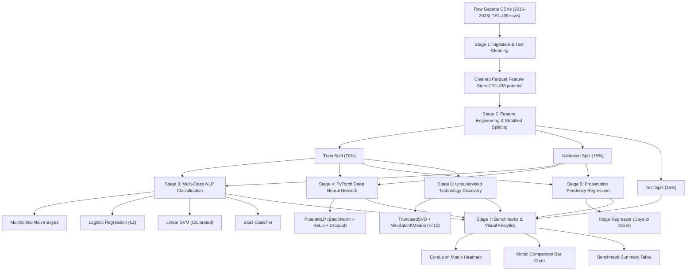

# Patent Intelligence & Machine Learning Pipeline

An end-to-end Machine Learning and NLP training pipeline built for the **Indian Patent Office (InPASS)** dataset (2016–2023, 151,438 records).

---

## 1. System Architecture



---

## 2. Directory Structure

```text
ml_pipeline/
├── config.py                      # Centralized configuration, hyperparams, and paths
├── run_pipeline.py                # 1-click master script executing stages 1 through 7
├── predict.py                     # CLI inference tool for classifying new patent titles
├── requirements.txt               # ML dependencies
├── README.md                      # Comprehensive documentation and benchmark reports
├── src/
│   ├── __init__.py
│   ├── data_cleaning.py           # Ingestion, quote stripping, date parsing, pendency derivation
│   ├── feature_engineering.py     # Stratified train/val/test splitting & TF-IDF vectorization
│   ├── train_classifier.py        # Multi-class NLP classification training & model selection
│   ├── train_neural.py            # PyTorch Deep MLP Text Classifier
│   ├── train_regressor.py         # Filing-to-grant examination pendency regression
│   ├── train_clustering.py        # Latent Semantic Analysis (SVD) + KMeans clustering
│   └── evaluate.py                # Visual plots generation (Confusion matrix, metric bar charts)
├── data/
│   ├── cleaned_patents.parquet    # Primary cleaned columnar dataset (151,438 rows)
│   ├── cleaned_patents_sample.csv # 5,000 row sample for easy manual inspection
│   ├── train_split.parquet        # Stratified training split (70%)
│   ├── val_split.parquet          # Validation split (15%)
│   ├── test_split.parquet         # Unseen test split (15%)
│   └── preprocessing_summary.json # High-level dataset ingestion statistics
├── models/
│   ├── tfidf_vectorizer.joblib    # Fitted n-gram TF-IDF vectorizer (15,000 features)
│   ├── label_encoder.joblib       # Fitted domain label encoder
│   ├── best_domain_classifier.joblib # Top-performing classification model
│   ├── all_classifiers.joblib     # Dictionary of all candidate classifiers
│   ├── neural_classifier.pt       # PyTorch deep neural network weights
│   ├── pendency_regressor.joblib  # Trained prosecution pendency regressor
│   └── kmeans_clustering.joblib   # SVD + MiniBatchKMeans thematic cluster models
└── reports/
    ├── classification_metrics.json# Detailed validation and test classification metrics
    ├── classification_report.txt  # Per-class precision, recall, and F1-score breakdown
    ├── neural_training_history.json # PyTorch training loss & validation accuracy curves
    ├── regression_metrics.json    # Regression MAE, RMSE, and R² scores
    ├── clustering_summary.json    # Discovered technology clusters and top keywords
    ├── benchmark_summary.csv      # Unified model comparison matrix
    ├── confusion_matrix.png       # Normalized 15-class test confusion matrix heatmap
    └── model_comparison.png       # Comparative visualization of models by metric
```

---

## 3. Data Cleaning & Feature Engineering

1. **Text Normalization**:
   - Removes encoding artifacts (`\ufffd`), quotes, and non-ASCII noise.
   - Cleans and lowercases invention titles for consistent tokenization.
2. **Date Standardization & Feature Derivation**:
   - Parses official InPASS dates (`DD/MM/YYYY`) into ISO standard (`YYYY-MM-DD`).
   - Computes `pendency_days`: $\text{Publication Date} - \text{Filing Date}$.
   - Derives `filing_year` and `publication_year`.
3. **Categorical Normalization**:
   - Standardizes `field_of_invention` across 15 engineering and science domains.
   - Maps and capitalizes IPO jurisdictions (`Delhi`, `Chennai`, `Kolkata`, `Mumbai`).
4. **Outlier Filtering & Imputation**:
   - Cleans `no_of_pages` and `no_of_claims`, imputing missing values with domain medians.
   - Resolves duplicate patent applications by unique `patent_id`.

---

## 4. Machine Learning Tasks

### Task 1: Multi-Class Patent Domain Classification
Predicts the technological field (`FIELD_OF_INVENTION`) solely from the invention title.
- **Multinomial Naive Bayes**: Fast probabilistic baseline using smoothed word likelihoods.
- **Logistic Regression (L2)**: High-dimensional linear boundary optimization.
- **Linear Support Vector Machine (LinearSVC with Calibrated Probabilities)**: Max-margin hyperplane optimization with isotonic/sigmoid probability calibration.
- **SGD Classifier (Modified Huber Loss)**: Stochastic gradient descent linear classifier.

### Task 2: Deep Learning Neural Text Classifier (PyTorch)
A deep Multi-Layer Perceptron (`PatentMLPClassifier`):
- `Linear(15000 -> 256)` $\to$ `BatchNorm1d` $\to$ `ReLU` $\to$ `Dropout(0.3)`
- `Linear(256 -> 128)` $\to$ `BatchNorm1d` $\to$ `ReLU` $\to$ `Dropout(0.2)`
- `Linear(128 -> 15)` $\to$ `CrossEntropyLoss`
- Optimized using `AdamW` with learning rate scheduling.

### Task 3: Prosecution Pendency Regression
Predicts examination duration (days to grant) from combined semantic TF-IDF representations, jurisdiction, application type, and claims count using regularized `Ridge` regression.

### Task 4: Unsupervised Technology Discovery
Discovers emerging and latent patent themes without supervision using `TruncatedSVD` (Latent Semantic Analysis, 50 components) and `MiniBatchKMeans` ($k=10$). Automatically extracts representative keywords per cluster.

---

## 5. How to Run

### Run Complete End-to-End Pipeline
```powershell
python ml_pipeline/run_pipeline.py
```

Optional arguments:
- `--sample_limit 30000`: Fast training on a 30,000-patent stratified sample.
- `--skip_cleaning`: Reuse existing cleaned parquet without re-parsing raw CSVs.
- `--skip_neural`: Run only scikit-learn models without PyTorch neural training.

### Run Single Patent Prediction
Classify any invention and estimate prosecution timeline:
```powershell
python ml_pipeline/predict.py --title "Novel dual-rotor wind turbine with permanent magnet generator"
```
Output:
- Primary predicted domain and percentage confidence.
- Top 3 alternative technology fields.
- Forecasted prosecution pendency in months and years.
- Discovered thematic cluster and associated research keywords.
